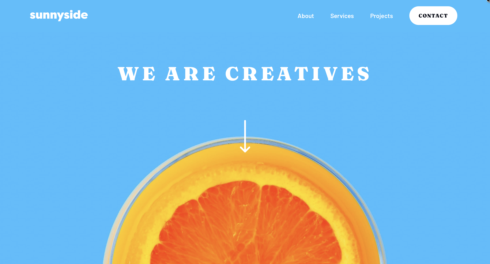

# Frontend Mentor - Sunnyside agency landing page solution

This is a solution to the [Sunnyside agency landing page challenge on Frontend Mentor](https://www.frontendmentor.io/challenges/agency-landing-page-7yVs3B6ef). Frontend Mentor challenges help you improve your coding skills by building realistic projects.

## Table of contents

- [Overview](#overview)
  - [The challenge](#the-challenge)
  - [Screenshot](#screenshot)
  - [Links](#links)
- [My process](#my-process)
  - [Built with](#built-with)
  - [What I learned](#what-i-learned)
  - [Continued development](#continued-development)
  - [Useful resources](#useful-resources)
  - [AI Collaboration](#ai-collaboration)
- [Author](#author)

## Overview

### The challenge

Users should be able to:

- View the optimal layout for the site depending on their device's screen size
- See hover states for all interactive elements on the page
- See a toast message on button click

### Screenshot



### Links

- Solution URL: [frontend-mentor](https://www.frontendmentor.io/solutions/responsive-landing-using-nextjs-tailwind-toast-notifications-ANcEP0aGCD)
- Live Site URL: [sunnyside-landing-vercel](https://sunnyside-landing-mu.vercel.app/)

## My process

### Built with

- [React](https://reactjs.org/) - JS library
- [Next.js](https://nextjs.org/) - React framework
- [Tailwind CSS](https://tailwindcss.com/)
- [Sonner](https://ui.shadcn.com/docs/components/radix/sonner)
- Semantic HTML5 markup
- Flexbox
- CSS Grid
- Mobile-first workflow

### What I learned

First of all, this project was a great way to practice my frontend development skills and expand my portfolio. I showcased my strengths in working with metadata, SEO, and a11y (accessibility). I also learned how to use the Intersection Observer API to dynamically change the header's background color depending on which section is currently visible on the screen:

```
useEffect(() => {
    const handleScroll = () => {
      setIsScrolled(window.scrollY > 70);
    };

    handleScroll();
    window.addEventListener("scroll", handleScroll, { passive: true });

    const sections = document.querySelectorAll<HTMLElement>(
      "[data-header-theme]",
    );
    const observer = new IntersectionObserver(
      (entries) => {
        entries.forEach((entry) => {
          if (entry.isIntersecting) {
            const newTheme = entry.target.getAttribute(
              "data-header-theme",
            ) as HeaderTheme;
            if (newTheme && HEADER_THEMES[newTheme]) {
              setSectionTheme(newTheme);
            }
          }
        });
      },
      {
        rootMargin: "-80px 0px -85% 0px",
        threshold: 0,
      },
    );

    sections.forEach((section) => observer.observe(section));

    return () => {
      window.removeEventListener("scroll", handleScroll);
      observer.disconnect();
    };
  }, []);
```

### Continued development

Moving forward, I want to keep pushing myself to build more complex projects that combine frontend, TypeScript, and backend development.

### Useful resources

- [DevDocs](https://devdocs.io/) -  An essential resource for reading documentation offline when power outages are part of your daily schedule.

### AI Collaboration

- I used Gemini to learn how to use an observer for tracking sections.
- It covered the basics and gave me some examples, which I improved by adjusting the observer's offset positioning.
  
## Author

- Website - [Dmytro Farbun](https://my-portfolio-main-eta-jade.vercel.app/)
- Frontend Mentor - [@Diamond-FoxUA](https://www.frontendmentor.io/profile/Diamond-FoxUA)
- LinkedIn - [@dmytro-farbun](https://www.linkedin.com/in/dmytro-farbun)
